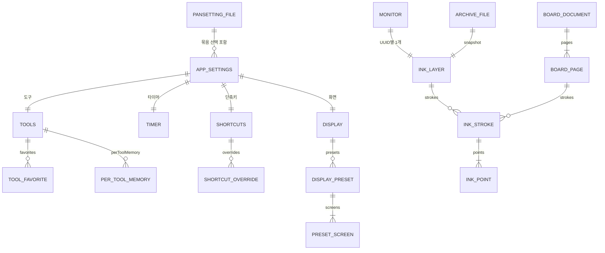

# 데이터 모델 / ERD

| 항목 | 내용 |
|---|---|
| 문서 ID | 03.02.05 |
| 작성자 | 이경환 (AI 초안) |
| 작성일 | 2026-10-31 |
| 버전 | 0.1 |
| 상태 | 초안 |
| 선행 문서 | 03_기능요구사항정의서 |
| 후행 문서 | 06_기술스택결정서, 07_API명세서, 08_작업실행계획 |

## 1. 개요
### 1.1 문서 목적
EduTools는 **DB 서버가 없는 로컬 앱**이다. 영속 데이터는 설정(JSON), 판서 보관(JSON), 내보내기 파일, 로그뿐이다. 이 문서는 그 데이터를 엔티티로 정리하고, "테이블"은 파일·키 구조로 읽는다. 파일 형식·호환 규칙은 07에서 인터페이스로 다룬다.

### 1.2 명명 규칙
- JSON 키는 camelCase(`autoArchiveEnabled`), 값 열거는 camelCase 문자열(`"penOnly"`).
- 단축키 식별자는 `<정의 id>|<범위>`(예: `edit.clear-all|global`), 키 토큰은 OS 중립 형식(`AppMod+E`, `Primary+Delete`).
- 좌표는 화면 크기 대비 비율(0~1), 시간은 초(실수) 또는 KST 표기(문서·로그).

### 1.3 표기법 (Crow's Foot, IE 등)
Mermaid `erDiagram`(Crow's Foot). 파일 단위 집합 관계는 "포함"으로 표시한다.

## 2. 개념 데이터 모델
### 2.1 핵심 엔티티 목록
| 엔티티 | 설명 | 영속 위치 |
|---|---|---|
| AppSettings | 설정 9개 묶음 | macOS UserDefaults / Windows `%APPDATA%\EduTools\settings.json` |
| ShortcutOverride | 사용자가 바꾼 단축키 | AppSettings.shortcuts |
| ToolFavorite | ★ 즐겨찾기(도구·색·크기·세부) | AppSettings.tools |
| PerToolMemory | 도구별 마지막 색·굵기 | AppSettings.tools |
| DisplayPreset / PresetScreen | 화면 구성 프리셋(주·보조1·보조2) | AppSettings.display |
| InkLayer | 모니터 하나의 판서층 | 메모리 + 보관 파일 |
| InkStroke / InkPoint | 획과 점(위치·압력·시간) | 보관 파일 |
| BoardDocument / BoardPage | 화이트·블랙보드와 페이지 | 메모리 + 보관 파일 |
| ArchiveFile | 판서 보관(자동·연결 해제) | 보관 폴더 JSON |
| PansettingFile | 설정 내보내기 파일 | 사용자 지정 `.pansetting` |
| SettingsBackup | 가져오기 직전 백업(최근 5개) | 앱 데이터 폴더 |
| LogFile | 이벤트 로그 | Windows `%LOCALAPPDATA%\EduTools\edutools.log` |

### 2.2 엔티티 관계 개요
설정은 하나의 AppSettings가 9개 묶음을 가지며, 판서층은 모니터(UUID)마다 하나씩 있고 획 여러 개를 가진다. 보드는 화면과 무관한 문서이며 페이지마다 획을 가진다. 보관 파일은 판서층의 스냅샷이다.

## 3. 논리 데이터 모델 (ERD)
### 3.1 ERD 다이어그램

(GENERAL·ERASER·ZOOM·BOARD·HELP 묶음은 APP_SETTINGS와 1:1이며 도식에서 생략)

### 3.2 엔티티 정의
3.1 도식과 2.1 표가 엔티티 정의다. 설정 묶음은 3.3에서 속성으로 정의한다.

### 3.3 속성 정의
**AppSettings 묶음 (최상위 키)**
| 묶음 | 주요 속성(예) |
|---|---|
| `general` | `launchAtLogin`, `autoArchiveEnabled`, `clearsInkWhenAnnotationModeEnds`, `displayDisconnectPolicy`, `automaticallyRestoresDisconnectedDisplays`, `archiveFolderPath` |
| `tools` | `colors`(프리셋 6), `perToolMemory`, `favorites`, `highlighterOpacity`, `laserColor/Size/TrailDuration`, `pressureMinimumWidthRatio` |
| `eraser` | `mode`, `diameter`, `presetDiameters`, `hitRule`, `targetFilter`, `areaShape` |
| `zoom` | `followMode`, `followSmoothness`, `liveByDefault`, `magnificationStep`, `maximumMagnification`, `previewDimming` |
| `board` | `whiteboardColor`, `blackboardColor`, `backgroundPattern` |
| `timer` | `breakDefaultMinutes`, `breakMessage`, `breakBackgroundColor`, `autoStartBreak`, `fadeEnabled`, `fadeDuration`, `musicEnabled`, `musicSource`, `playlistURLs`, `defaultPlaylistIndex`, `musicBrowser`, `musicFolderPath`, `musicOrder`, `musicRepeat` |
| `display` | `autoSwitchEnabled`, `presets` |
| `shortcuts` | `appModifier`, `overrides` |
| `help` | `showsHelpInSharing` |

**InkStroke**
| 속성 | 타입 | 필수 | 설명 |
|---|---|---|---|
| identifier | string | Y | 획 ID(PK) |
| tool | enum | Y | `pen`·`highlighter`·`shape`·`text`·`cover` |
| color | number[4] | Y | RGBA 0~1 |
| width | number | Y | 굵기(pt) |
| usesPressure | bool | Y | 필압 사용 |
| points | InkPoint[] | Y | 점 배열 |
| content | object | N | 도형·텍스트 부가 내용 |

**InkPoint**: `location`(비율 x,y), `pressure`(0~1), `timestamp`(초).
**DisplayPreset**: 이름(1~40자), `screens`(주·보조1·보조2, 모니터 목록), 격자 위치 `x,y ∈ −1..1`, `autoMatch`, 모니터 식별(`uuid`,`vendor`,`model`,`serial`,`name`,`kind`) — 상세 `design.md` "화면 구성 프리셋".
**PansettingFile**: `format`(`kr.datasci.edutools.pansetting`), `formatVersion`(1), `appVersion`, `createdOS`, `includedBundles`, `includesComputerSpecific`, `payload`(묶음별 설정).

### 3.4 관계 정의 (카디널리티, 참조 무결성)
- MONITOR 1 : INK_LAYER 1 (디스플레이 UUID 기준). 모니터가 사라져도 판서층은 UUID로 보관한다(무결성 규칙: 판서는 삭제하지 않고 정책에 따라 보관·이동·삭제).
- INK_STROKE ≥ 1 INK_POINT(점 없는 획은 저장하지 않음 [확인 필요]).
- DisplayPreset ≤ 8, 프리셋 이름은 목록 내 중복 가능 여부 [확인 필요].

### 3.5 식별자 (PK / FK / UK)
| 엔티티 | PK | 비고 |
|---|---|---|
| InkStroke | `identifier` | |
| ShortcutOverride | `<정의 id>\|<범위>` | UK |
| ArchiveFile | 날짜/시각 + 모니터 해시 8자 | 파일명 |
| Monitor | 디스플레이 UUID(macOS) / 장치 경로·EDID 기반 식별(Windows) | 식별 우선순위는 `windows-plan.md` |

## 4. 물리 데이터 모델
### 4.1 테이블 정의서
파일·저장소 정의로 대체한다.
| 데이터 | 형식 | 위치 | 쓰기 방식 |
|---|---|---|---|
| 설정 | JSON(Windows) / UserDefaults(macOS) | `%APPDATA%\EduTools\settings.json` | 임시 파일 + 교체(원자적), 손상 시 `*.corrupt.json` 분리 |
| 자동 보관 | JSON(`formatVersion` 1) | `<보관 루트>/<yyyy-MM-dd>/<시각>-<해시8>.json` | 원자적 쓰기 |
| 연결 해제 보관 | 동일 | `<보관 루트>/disconnected/<해시8>.json` | 원자적 쓰기 |
| PNG·PDF | PNG / PDF | 사진 폴더 `EduTools`(또는 설정 폴더), `<타임스탬프>-<DISPLAYn>.png` | 작업 스레드, 원자적 쓰기 |
| 설정 백업 | JSON | 앱 데이터 폴더, 최근 5개 | 적용 전 자동 |
| 로그 | 텍스트 | `%LOCALAPPDATA%\EduTools\edutools.log` | 이벤트 단위 |

### 4.2 인덱스 설계
해당 없음(파일 직접 접근). 검색 성능이 필요한 곳은 획의 경계 사각형 보관(지우개 교차 판정)뿐이며 메모리 구조다.

### 4.3 파티셔닝 / 샤딩 전략
해당 없음. 보관 파일은 날짜 폴더로 자연 분리된다.

## 5. 데이터 사전
### 5.1 코드 테이블
| 코드 | 값 |
|---|---|
| `eraser.mode` | `partial`·`stroke`·`area` |
| `eraser.hitRule` | `touching`·`contained` |
| `eraser.targetFilter` | `all`·`penOnly`·`highlighterOnly` |
| `eraser.areaShape` | `rectangle`·`lasso` |
| `zoom.followMode` | `always`·`edge`·`fixed` |
| `board.backgroundPattern` | `none`·`grid`·`lines` |
| `general.displayDisconnectPolicy` | `archive`·`moveToPrimary`·`delete` |
| `timer.musicSource` | `youtube`·`folder` |
| `timer.musicOrder` / `musicRepeat` | `name`·`shuffle` / `all`·`one` |
| `timer.musicBrowser` | `chrome`·`youtubeMusicApp`·`defaultBrowser` |
| 배지 크기 / 표시 | `small`·`medium`·`large` / `remaining`·`elapsed` |
| 화살표 | `single`·`double` |
| 단축키 범위 | `global`·`annotation`·`zoom` |

### 5.2 공통 컬럼
공통 감사 컬럼은 없다. 파일 단위 공통 필드: `formatVersion`(보관·`.pansetting`), `appVersion`·`createdOS`(`.pansetting`).

## 6. 데이터 이관 및 초기 데이터
- **초기 데이터**: `AppSettings.default`(기본값). 설정 파일이 없으면 기본값으로 시작하고 로그에 출처를 남긴다.
- **버전 이행**: `perToolMemory`가 없는 구버전 설정은 옛 `penWidth`·`highlighterWidth`·`textFontSize`에서 이행한다(재기록 안 함). 새 키는 추가 필드로 두고 `formatVersion`을 올리지 않는다.
- **호환 검증**: 버전별 골든 설정(`Tests/Fixtures/settings/v0.1.0`)과 교차 플랫폼 픽스처(`fixtures/shortcuts-default.json`, `fixtures/pansetting/*`)를 시험이 읽는다.
- **OS 이전**: `.pansetting`은 컴퓨터별 값(모니터별 위치·보관 폴더 경로·`autoSwitchEnabled`)을 기본 제외한다.

## 7. 데이터 보안 및 보존 정책
| 항목 | 정책 |
|---|---|
| 개인정보 | 수집·전송 없음. 판서 내용은 로컬 파일에만 존재 |
| 민감 값 | 설정에 비밀번호·토큰 없음. 유튜브 로그인 정보는 앱이 읽지 않음 |
| 경로 안전 | `musicFolderPath`의 UNC·장치 경로(`\\…`, `\??\…`)는 가져오기·편집 모두 거부(SMB 인증 정보 유출 방지) |
| URL 안전 | 재생목록은 `https://music.youtube.com/` 시작만 허용 |
| `.pansetting` 내용 | 재생목록 주소·폴더 경로가 들어갈 수 있어 내보내기 화면에서 안내 |
| 보존 | 자동 보관 파일 보존 기간·정리 정책 [확인 필요] (현재 자동 삭제 없음 [가정]) |
| 손상 | 설정 파일 손상 시 분리 보관 후 기본값, 사용자에게 알림 |

## 변경 이력

| 버전 | 일자 | 변경 내용 | 작성자 |
|---|---|---|---|
| 0.1 | 2026-10-31 | 최초 작성(기존 제품 현황 기준 역작성) | 이경환 (AI 초안) |
