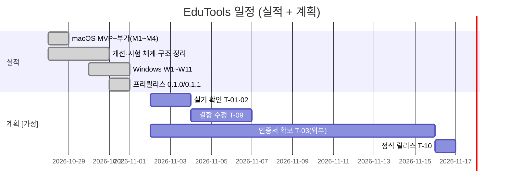

# 작업 실행 계획

| 항목 | 내용 |
|---|---|
| 문서 ID | 03.02.08 |
| 작성자 | 이경환 (AI 초안) |
| 작성일 | 2026-10-31 |
| 버전 | 0.1 |
| 상태 | 초안 |
| 선행 문서 | 03~07 전체 설계 문서 |
| 후행 문서 | 10_회고 |

## 1. 개요
### 1.1 문서 목적
완료된 작업의 실적과 남은 작업의 계획을 한 표로 관리한다. 개별 PR 단위 이력의 정본은 [`ROADMAP.md`](../ROADMAP.md)와 `git log`이며 이 문서는 마일스톤·남은 일을 맡는다(중복 기술 금지).

### 1.2 계획 기준일
2026-10-31 (main `3a93ba6` 이후, PR #142까지). 개발 시작 2026-10-28.

## 2. 마일스톤
### 2.1 마일스톤 목록
| ID | 마일스톤 | 기간 | PR | 상태 |
|---|---|---|---|---|
| M1 | MVP: 골격·판서·지우개·팔레트 | 10-28 | #1~#4 | 완료 |
| M2 | 보드·타이머·쉬는 시간 음악 | 10-28 | #5~#7 | 완료 |
| M3 | 줌 | 10-28 | #8 | 완료 |
| M4 | 부가 기능·내보내기·설정·배포 경로 | 10-28 | #9~#13 | 완료 |
| M5 | 개선: 원형 팔레트·통과 모드·화면 구성 프리셋·즐겨찾기·줌 판서 | 10-28~10-30 | #15~#94 | 완료 |
| M6 | 시험 체계(SwiftPM·Swift Testing·E2E·릴리스 검증) | 10-29 | #56~#65 | 완료 |
| M7 | 구조 정리 1~6차(동작 불변) | 10-29 | #70~#77 | 완료 |
| M8 | Windows W1~W11(코어·판서·팔레트·줌·설정·화면 구성·발표·내보내기·설치기) | 10-30~10-31 | #95~#137 | 구현 완료, 실기 대기 |
| M9 | `v0.1.0`·`v0.1.1` 프리릴리스 | 10-31 | #141 | 완료 |
| M10 | 로컬 폴더 음악, 전체 지우기 전역 키 | 10-31 | #138~#142 | 완료 |
| M11 | 실기 확인 통과 | 미정 | - | 대기 |
| M12 | 서명·공증 정식 릴리스(자동 업데이트 포함 여부 결정) | 미정 | - | 대기 |

### 2.2 릴리스 일정
| 버전 | 날짜 | 내용 |
|---|---|---|
| 0.1.0 | 2026-10-31 | 첫 프리릴리스(macOS·Windows) |
| 0.1.1 | 2026-10-31 | 로컬 폴더 음악, 내보내기 개선, 경로 보안 |
| 0.1.2 (예정) | M11 이후 | 전체 지우기 전역 키(#142) 포함, 실기 결함 수정 |
| 1.0 (가칭) | M12 이후 | 서명·공증, 정식 배포 |

## 3. 작업 분해 (Task Breakdown)
### 3.1 에픽 / 스토리 / 태스크 구조
에픽 = PRD 요구사항 묶음(PR-xx), 스토리 = 04 사용자 스토리(US-xx), 태스크 = 작업 지시서 1건(`tasks/eduTools-NNN`, PR 1개). 완료분은 ROADMAP 번호(001~126)가 태스크 ID다.

| 에픽 | 스토리 | 상태 |
|---|---|---|
| EP-01 판서 | US-01~03 | 구현 |
| EP-02 줌 | US-04 | 구현 |
| EP-03 타이머·음악 | US-05, 06 | 구현 |
| EP-04 멀티 모니터·저장 | US-07, 08 | 구현(실기 대기) |
| EP-05 설정·배포 | US-09, 10 | 구현, 서명·업데이트 미완 |

### 3.2 태스크 목록 (ID, 이름, 담당, 예상 공수)
**남은 태스크** (공수는 [가정])
| ID | 태스크 | 담당 | 공수 | 선행 |
|---|---|---|---|---|
| T-01 | Windows 실기 체크리스트 18항목 실행(펜·DPI·IME·절전·전체화면·음악 청취·전체 지우기 키 등) | 이경환 | 1일 | - |
| T-02 | macOS 실기(권한·펜 태블릿·iPad·팔레트 육안·E2E 권한 터미널) | 이경환 | 1일 | - |
| T-03 | 코드 서명 인증서·Apple Developer 확보, 설치 프로그램 게시자명 결정 | 이경환 | 외부 의존 | - |
| T-04 | 자동 업데이트 방식·배포 주소 결정 | 이경환 | 0.5일 | - |
| T-05 | 자동 업데이트 구현(Sparkle / WinSparkle 또는 대안) | Codex(Claude 검수) | 3일 | T-04 |
| T-06 | Windows "현재 모니터만 지우기" 구현(트레이 "전체 지우기"는 완료) | Codex | 0.5일 | - |
| T-07 | 성능 후보 9건 실GPU 실측(`park-edutools-windows-perf-candidates`) | 이경환 → Codex | 1일 | T-01 |
| T-08 | 가로 팔레트 클릭 누수 재현·원인 규명 | 이경환 → Codex | 1일 | 재현 조건 |
| T-09 | 실기 결함 수정 라운드(`v0.1.2`) | Codex(Claude 검수) | T-01 결과 | T-01, 02 |
| T-10 | 서명·공증 정식 릴리스 | Claude(빌드)·이경환(승인) | 0.5일 | T-03, 09 |
| T-11 | 문서 01~10 검토·승인 | 이경환 | 0.5일 | - |

**완료 태스크 요약**: M1~M10 (3.1 표·ROADMAP). 라운드 수 126(번호), 병합된 PR 142건.

### 3.3 선행 / 후행 관계
```
T-01 ─┬─▶ T-09 ─┬─▶ T-10 ─▶ 정식 릴리스
T-02 ─┘         │
T-03 ───────────┘            T-04 ─▶ T-05
T-01 ─▶ T-07        T-08(재현 후)        T-06(독립)    T-11(독립)
```

### 3.4 크리티컬 패스
**T-03(인증서) → T-10**. 외부 조달이라 가장 길고 불확실하다. 병행 가능한 T-01·02·09는 인증서 대기 중에 끝낼 수 있다. 일정 리스크가 큰 태스크: T-03(외부), T-05(결정 선행).

## 4. 일정
### 4.1 간트 차트


### 4.2 스프린트 계획
스프린트는 쓰지 않는다. **라운드**(작업 지시서 1건 = 브랜치·PR 1개)로 진행한다. 흐름: 분석·지시서 → 구현(Codex) → 검수·게이트(Claude) → PR·머지 → 태그·빌드·배포 검증. 병렬 라운드는 worktree로 분리한다.

## 5. 자원 계획
### 5.1 역할 및 담당자
| 역할 | 담당 | 책임 |
|---|---|---|
| 기획·승인·실기 확인 | 이경환 | 요구·결정, 실기 장비 시험, 승인, 인증서 |
| 분석·지시·검수·배포 | Claude | 지시서, 게이트(시험·변이·diff 점검), PR·머지, 빌드·릴리스, 문서 |
| 구현 | Codex | 지시서 범위 안 코드·시험 수정(`codex exec`) |

### 5.2 투입 계획
전담 인원이 없고 1인 + AI 협업이다. 실기 확인(T-01·02)에만 사용자 시간이 필요하고 나머지는 라운드 단위로 자동 진행 가능하다 [가정].

## 6. 리스크 및 대응
### 6.1 일정 리스크
| 리스크 | 영향 | 대응 |
|---|---|---|
| 인증서 조달 지연 | 정식 릴리스 지연 | 프리릴리스로 계속 배포, 경고 안내 |
| 실기에서 대형 결함 | `v0.1.2` 범위 확대 | T-09를 라운드로 쪼개 우선순위화 |
| 사용자 가용 시간 | 실기 확인 지연 | 체크리스트를 항목별로 독립 실행 가능하게 유지 |

### 6.2 기술 리스크
| 리스크 | 대응 |
|---|---|
| Windows VM과 실기 성능 차이 | T-07로 재측정 |
| macOS·Windows 동작 이탈 | 교차 플랫폼 픽스처·골든 시험, 변경 시 양쪽 PR |
| 저장소 private 전환으로 VM 빌드 인증 불가 | 소스 동기(`vm-build-src.ps1`) 사용 |

## 7. 추적 방법
### 7.1 진척 관리 도구
- `ROADMAP.md`(PR 단위 실적, 저장소)
- 작업 공간의 `tasks/<id>.md`(지시서)·`reports/eduTools-windows-progress.md`(Windows 라운드 장부)·`tasks/OPEN-ITEMS.md`(미해결 정본)
- GitHub Releases(릴리스 이력)

### 7.2 보고 주기
라운드 종료마다(머지·검증 결과) + 릴리스마다 요약. 정기 점검에는 결정 대기 항목을 항상 덧붙인다.

## 변경 이력

| 버전 | 일자 | 변경 내용 | 작성자 |
|---|---|---|---|
| 0.1 | 2026-10-31 | 최초 작성(실적 역정리 + 남은 계획) | 이경환 (AI 초안) |
